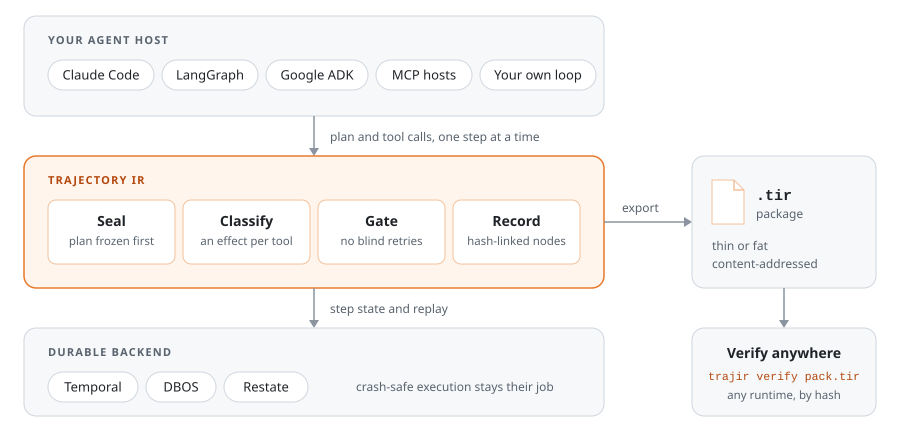
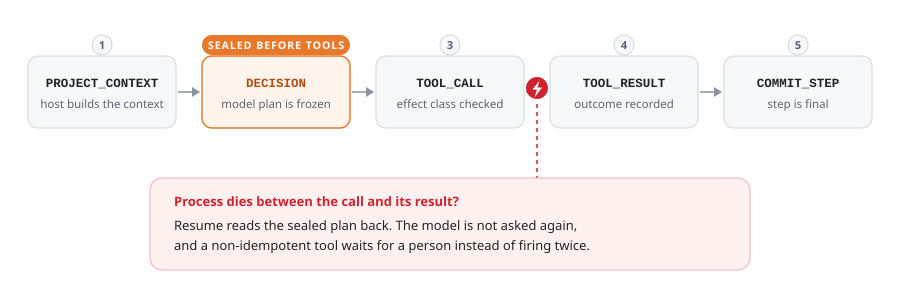

<div align="center">

<picture>
  <source media="(prefers-color-scheme: dark)" srcset="docs/assets/readme/logo-dark.png">
  
</picture>

<h1>Trajectory IR</h1>

**A flight recorder for AI agent runs.**

Record what an agent decided and did as typed, hash-linked nodes,<br>
then export the run as a `.tir` package anyone can verify.

[](https://github.com/Coder-s-OG-s/Trajectory-IR/actions/workflows/ci.yml)
[](https://www.bestpractices.dev/projects/14075)
[](https://scorecard.dev/viewer/?uri=github.com/Coder-s-OG-s/Trajectory-IR)
[](LICENSE)

[](go/QUICKSTART.md)
[](QUICKSTART.md)
[](docs/MASTER_SPECIFICATION.md)
[](https://discord.gg/qn6zHrPMr)

[Quick start](#quick-start) ·
[How it works](#how-it-works) ·
[Use it with your agent](#use-it-with-your-agent) ·
[Docs](#documentation) ·
[Contributing](#contributing)

</div>

---

## What is Trajectory IR?

AI agents call tools that change the real world. They deploy, pay, send email, and delete things. When a run crashes halfway, or someone asks a week later what the agent actually did, a chat transcript is a poor record.

Trajectory IR is a small library that keeps that record properly. It:

- **Seals the plan.** The model's decision is frozen before any tool with side effects runs.
- **Classifies every tool call** by its effect, and assumes the worst when it does not know.
- **Does not blindly retry a dangerous call** after a crash. It stops and waits for a person.
- **Exports the run** as a `.tir` package that is checked by content hash, on any runtime.

<p align="center">
  <picture>
    <source media="(prefers-color-scheme: dark)" srcset="docs/assets/readme/architecture-dark.svg">
    
  </picture>
</p>

> [!NOTE]
> Trajectory IR sits **on top of** durable execution engines such as Temporal, DBOS, and Restate. It does not replace them, and it is not another agent framework.

New here? The [audit walkthrough](docs/AUDIT_WALKTHROUGH.md) records an agent run, verifies it offline, and shows an edited copy failing. About ten minutes, no API key.

## Why it exists

Crash replay is already the job of Temporal, DBOS, and Restate. What they do not give you is a portable, hash-verifiable record of what the agent decided and invoked, with agent-shaped policy on top. Three gaps keep showing up in production agent stacks:

- **A crash mid-tool gets retried blindly.** The deploy or the payment fires twice.
- **Resume asks the model again.** The agent quietly follows a different plan than the one it started.
- **The history is locked in one runtime.** Nobody outside it can check what happened.

## How it works

Each agent step is recorded as a chain of typed nodes. The plan is sealed before the tools run.

<p align="center">
  <picture>
    <source media="(prefers-color-scheme: dark)" srcset="docs/assets/readme/step-flow-dark.svg">
    
  </picture>
</p>

| Idea | In one line |
|---|---|
| **Sealed decision** | The model's plan (`DECISION`) is frozen before world-changing tools run. The world is not frozen with it. |
| **Effect classes** | Every tool call carries one of six classes. Unknown tools get the most restrictive one. |
| **Honest resume** | A sealed step is not planned again (R01). Looking at the world again is allowed, and a new plan is a new step. Hosts that declared a `WORLD_SNAPSHOT` get a loud `WORLD_DRIFT` from `CheckWorld`. |
| **Block-and-gate** | An interrupted non-idempotent call is not retried on its own (R02). It becomes `BLOCKED_NEEDS_GATE` for a person. That is at most one automatic attempt, not exactly-once. |
| **Idempotency key** | Every `TOOL_CALL` carries a seal-derived `sha256` key. Your host forwards it to the remote API as `Idempotency-Key`. |
| **`.tir` package** | Thin or fat export with content-addressed identity and optional `trajir-pkg-sig-v1` signatures. |
| **Sandbox mode** | Same agent, but the three gated classes are rejected before the tool body runs (R06). A gate for demos and CI, not a process sandbox. |
| **Conformance suite** | R01 to R11, runnable across Go and Python. |

<details>
<summary><b>The six effect classes</b></summary>

<br>

| Class | Meaning | After a crash |
|---|---|---|
| `PURE` | No external change | May recompute freely |
| `READ_ONLY` | Reads an external system | May re-fetch. A different answer is recorded as a new result |
| `IDEMPOTENT_WRITE` | Write that is safe to retry with the same key | Replay with the same key |
| `NON_IDEMPOTENT_WRITE` | Deploy, payment, email, delete, or anything ambiguous | Block-and-gate: needs a person |
| `AGENT_SPAWN` | Starts another agent | Block-and-gate |
| `SENSITIVE` | Touches secrets or PII | Block-and-gate when no base class is known |

A missing class or an unknown tool name is `NON_IDEMPOTENT_WRITE`. So are open-world tools such as `bash`, `python`, `sql`, and the browser, unless an operator sets the class on the tool. There is no command parser.

</details>

## Quick start

**You need:** Go 1.26.0 or newer and Git. No services, no API keys. With the default `GOTOOLCHAIN=auto`, the first build downloads the pinned 1.26.11 toolchain once.

```bash
git clone https://github.com/Coder-s-OG-s/Trajectory-IR.git
cd Trajectory-IR/go
go test ./...                     # run the test suite
go run ./examples/adoption_host   # watch a host seal and run one step
```

One step, in Go:

```go
tr, err := client.OpenTrajectory("demo", "qs-1", client.Options{WorkDir: dir})

// 1. Project the context for step 1
tr.Project(1, map[string]any{"goal": "hello"})

// 2. Seal the model's plan before any tool runs
tr.SealDecision(1, map[string]any{
    "tool_calls": []any{
        map[string]any{"name": "echo", "args": map[string]any{"msg": "hi"}},
    },
})

// 3. Run the tool under its effect class
res, err := tr.ExecTool(1, 2, tool, map[string]any{"msg": "hi"})
fmt.Println(res.Result) // hi

// 4. Commit the step
tr.CommitStep(1, 4)
```

The complete program, Temporal notes, and the kill-mid-deploy demo are in **[go/QUICKSTART.md](go/QUICKSTART.md)**.

<details>
<summary><b>Python reference port</b></summary>

<br>

```bash
cd Trajectory-IR
python -m venv .venv
# Windows: .\.venv\Scripts\activate
# Unix:    source .venv/bin/activate
pip install -U pip
pip install -e ".[dev]"
pytest conformance/ -q
```

`.[dev]` includes DBOS. Outside the repo, a base install covers the client, node log, projection, and `.tir` export. `pip install "trajectory-ir[dbos]"` adds the DBOS backend that the default `make_run_step` hooks use.

More in **[QUICKSTART.md](QUICKSTART.md)** and the [kill-mid-deploy demo](examples/kill_mid_deploy/).

</details>

## Use it with your agent

| Host | How it attaches | Seals the host's tool calls? |
|---|---|---|
| **Claude Code** | Project-local hooks, written by the installer | Yes |
| **LangGraph** | `TrajIRToolGuard` wraps the tool node | Yes, and it gates the tool body |
| **Google ADK** | `AdkToolGuard` callbacks | Yes. The callbacks do not call the tool |
| **Cursor, VS Code, Gemini CLI, Codex** | Project MCP config, written by the installer | No. The MCP tools report status and export or check packs |
| **Your own loop** | The [Go](go/QUICKSTART.md) or [Python](QUICKSTART.md) client | Yes |

### One-step install

Run this from a Trajectory IR checkout. With no target it attaches to the checkout itself.

```bash
./scripts/install_claude.sh --target /path/to/your/project
```

```powershell
pwsh -File scripts\install_claude.ps1 -Target C:\path\to\your\project
```

The installer:

1. Builds `trajir.exe`, `trajir-mcp.exe`, and `trajir-console.exe`. The names keep `.exe` on every OS.
2. Writes hooks and MCP config into the target project. Your user profile is not edited.
3. Seals one local pack through the library and prints `INSTALL OK`. This does not run the hook scripts.
4. Starts the local console on `127.0.0.1:8787` if that port is free. Pass `--skip-console` to skip it.

Then check any pack you export:

```bash
./go/trajir.exe verify path/to/pack.tir
```

Every file the installer writes, the hook exit codes, and a troubleshooting table are in **[USERS.md](USERS.md)**.

<details>
<summary><b>LangGraph and Google ADK snippets</b></summary>

<br>

LangGraph gates the tool body:

```python
from integrations.langgraph import TrajIRToolGuard

guard = TrajIRToolGuard(tenant_id="demo", trajectory_id="lg-live", work_dir=".local-evidence/lg-live")
tools = ToolNode(my_tools, wrap_tool_call=guard.wrap_tool_call)
```

Google ADK uses the same seal through callbacks:

```python
from integrations.adk import AdkToolGuard

guard = AdkToolGuard(tenant_id="demo", trajectory_id="adk-live", work_dir=".local-evidence/adk-live")
agent = Agent(
    tools=my_tools,
    before_tool_callback=guard.before_tool_callback,
    after_tool_callback=guard.after_tool_callback,
)
```

The installer also drops both snippets into `.trajir/` in the target project.

</details>

## What it is, and what it is not

| Trajectory IR **is** | Trajectory IR **is not** |
|---|---|
| A portable runtime IR and `.tir` package for agent trajectories | LLVM, bytecode, or a compiler for prompts |
| Seals, effect classes, resume semantics, hash-verifiable export | A replacement for Temporal, DBOS, or Restate (adapters only) |
| A thin layer over pluggable durable backends | An agent orchestration framework |
| An at-most-one automatic retry policy, plus a key you can forward | Exactly-once remote writes (that is the server's idempotency key) |
| A demo and CI effect-class gate | A process sandbox, a `bash` AST analyzer, or a security boundary |
| Open source libraries under Apache-2.0 | A hosted control plane or a long-term memory product |

The "IR" is a *runtime* trajectory IR. Nothing is compiled ahead of time. A host lowers each live agent step into typed, content-addressed nodes that you can project, redact, graft, verify, and export.

Scope in one page: [docs/SCOPE_AND_NON_GOALS.md](docs/SCOPE_AND_NON_GOALS.md). Limits to read before a security review: [USERS.md](USERS.md#limits).

## Repository layout

```text
go/             Go SDK, the primary implementation (client, resume, effects, tir, console, MCP)
pkg/            Python reference port (trajectory_ir)
conformance/    R01 to R11 conformance tests (the Go twin is in go/conformance)
integrations/   Claude Code hooks, LangGraph, Google ADK, MCP, OpenTelemetry
examples/       Runnable demos: kill_mid_deploy, adoption_host, host_loop
scripts/        Installers and local tooling
test/           Python unit, integration, and end-to-end tests
docs/           Specification, roadmap, and design notes
website/        MkDocs docs site and demo runbook
```

## Documentation

| If you are | Read |
|---|---|
| New to the project | This page, then [go/QUICKSTART.md](go/QUICKSTART.md) and the sandbox and kill-mid-deploy demos |
| Attaching it to an agent | [USERS.md](USERS.md), then [docs/INTEGRATIONS.md](docs/INTEGRATIONS.md) |
| Reviewing security or compliance | [docs/SCOPE_AND_NON_GOALS.md](docs/SCOPE_AND_NON_GOALS.md) and [SECURITY.md](SECURITY.md) |
| Contributing code | [CONTRIBUTING.md](CONTRIBUTING.md) |
| An AI coding agent | [docs/MASTER_SPECIFICATION.md](docs/MASTER_SPECIFICATION.md) and [AI_POLICY.md](AI_POLICY.md). Implement the spec, do not invent behavior |

<details>
<summary><b>All documentation</b></summary>

<br>

| Doc | What it covers |
|---|---|
| [docs/MASTER_SPECIFICATION.md](docs/MASTER_SPECIFICATION.md) | The normative contract: architecture, data model, protocols |
| [QUICKSTART.md](QUICKSTART.md) | Repo-wide quickstart for Go and Python |
| [USERS.md](USERS.md) | Setup and daily use: install, agents, MCP, console, storage |
| [docs/INTEGRATIONS.md](docs/INTEGRATIONS.md) | Host and backend integration notes |
| [docs/COMPATIBILITY.md](docs/COMPATIBILITY.md) | What stays stable across releases (proposal) |
| [docs/AUDIT_WALKTHROUGH.md](docs/AUDIT_WALKTHROUGH.md) | Record a run, verify it, tamper with it, sign it |
| [docs/PERFORMANCE.md](docs/PERFORMANCE.md) | Benchmarks and how to rerun them |
| [docs/ROADMAP.md](docs/ROADMAP.md) · [CHANGELOG.md](CHANGELOG.md) · [docs/RELEASE.md](docs/RELEASE.md) | Where the project is going, what shipped, how releases are cut |
| [website/](website/README.md) | Docs site source, demos, and the speaker runbook |
| [docs/ARTICLE_12_FIELD_MAP.md](docs/ARTICLE_12_FIELD_MAP.md) | Names the pack fields. It is not a compliance claim |

</details>

## Project status

| | |
|---|---|
| **Release** | [v0.3.0](CHANGELOG.md) |
| **Spec** | `spec-v0.2-draft`, see the [master specification](docs/MASTER_SPECIFICATION.md) |
| **Phase** | 1C, harden and adopt. Go is primary and Python keeps parity. See the [roadmap](docs/ROADMAP.md) |
| **OpenSSF** | [Best Practices project 14075](https://www.bestpractices.dev/projects/14075) · [Scorecard report](https://scorecard.dev/viewer/?uri=github.com/Coder-s-OG-s/Trajectory-IR) |
| **CNCF Sandbox** | Preparing an [application](docs/CNCF_SANDBOX_APPLICATION_OUTLINE.md). No CNCF membership is claimed until the TOC approves |
| **Adopters** | An honest empty list. Add yourself to [ADOPTERS.md](ADOPTERS.md) by pull request |

## Contributing

Students, first-time open source contributors, and experienced systems engineers are all welcome.

1. **Pick something.** Start with a [`good first issue`](https://github.com/Coder-s-OG-s/Trajectory-IR/issues?q=is%3Aissue+is%3Aopen+label%3A%22good+first+issue%22) and comment that you are taking it. Larger ideas are in [docs/MENTORSHIP.md](docs/MENTORSHIP.md).
2. **Get it running.** `cd go && go test ./...` is the whole setup for Go.
3. **Make the change.** New features go in Go first (`go/trajir`). Keep the Python port green.
4. **Sign off every commit.** The DCO is required:

   ```bash
   git commit -s -m "feat: short description"
   ```

5. **Open a pull request.** [CONTRIBUTING.md](CONTRIBUTING.md) explains what CI runs and how review works.

Two rules save the most review time:

- **Spec before code.** If the spec does not say, open a *Spec question* issue. Do not invent behavior.
- **Adapters only.** Do not reimplement durable execution: no retry, lease, or crash engines.

Good places to begin are docs and quickstarts, conformance and unit tests, and sandbox, redaction, or packaging edge cases.

Also read: [Code of Conduct](CODE_OF_CONDUCT.md) · [Governance](GOVERNANCE.md) · [Maintainers](MAINTAINERS.md) · [AI policy](AI_POLICY.md)

## Community

- **Chat:** [Discord](https://discord.gg/qn6zHrPMr)
- **Questions and ideas:** [GitHub Discussions](https://github.com/Coder-s-OG-s/Trajectory-IR/discussions)
- **Bugs and feature requests:** [open an issue](https://github.com/Coder-s-OG-s/Trajectory-IR/issues/new/choose)
- **Community calls:** open to everyone. The agenda and date are posted in Discussions before each call ([meeting 1](https://github.com/Coder-s-OG-s/Trajectory-IR/discussions/257)). Notes from past calls are in [docs/community/](docs/community/README.md).

## Security

Report vulnerabilities privately, as described in [SECURITY.md](SECURITY.md). Please do not open a public issue for an undisclosed security bug.

## License

Apache License 2.0. See [LICENSE](LICENSE) and the [third-party notices](docs/THIRD_PARTY_LICENSES.md).

## Acknowledgments

Trajectory IR builds on ideas and prior art from durable execution (Temporal, DBOS, Restate), MCP tool annotations, and the CNCF TAG Infrastructure discussion of agentic AI storage needs. See §3.1 and §18 of the [master specification](docs/MASTER_SPECIFICATION.md).

---

<p align="center">
  <sub>When chat and the spec disagree, the spec wins: <a href="docs/MASTER_SPECIFICATION.md">docs/MASTER_SPECIFICATION.md</a></sub>
</p>
